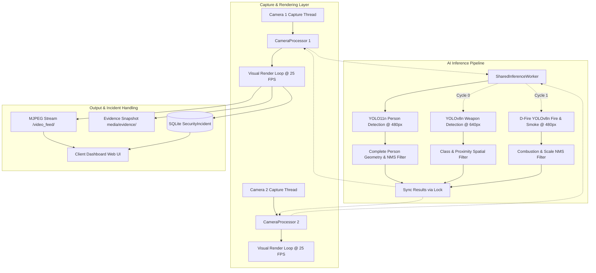

# Smart Video Surveillance & Threat Detection System

[](https://www.python.org/)
[](https://www.djangoproject.com/)
[](https://github.com/ultralytics/ultralytics)
[](https://opencv.org/)
[](LICENSE)

An enterprise-ready, AI-driven Smart CCTV Surveillance, Threat Detection, and Hazard Warning Platform engineered for real-time monitoring across live video feeds (webcams, RTSP/IP cameras) and forensic media uploads. Built on top of **Django**, **OpenCV**, and **Ultralytics YOLO (YOLO11n, custom weapon YOLOv8n, and fine-tuned D-Fire YOLOv8n)**, the system delivers high-precision person tracking, custom restricted zone intrusion boundaries, armed weapon identification (knife & pistol), real-time fire and smoke combustion hazard alerting, automated evidence snapshot logging, and interactive security telemetry.

Engineered specifically with **CPU-first interleaved scheduling**, allowing the entire multi-model AI suite to operate seamlessly on standard low-power laptops (e.g. Intel Core i3 dual-core CPUs with integrated graphics) with sub-second latency and zero thermal throttling.

---

## Key Capabilities & Features

### 1. Accurate Person Detection & Complete-Person Geometry
- **Complete Body Geometry Filtering:** Evaluates candidate bounding boxes using aspect ratio ($0.60 \le \text{aspect} \le 4.0$), physical dimensions ($h \ge 110\text{px}, w \ge 65\text{px}$), and minimum pixel volume ($\text{area} \ge 8,000\text{px}^2$).
- **Anti-Limb & Hand Suppression:** Distinguishes between complete human torsos/occupants and isolated arms or hands. Raising a hand or waving does not register as a person or inflate headcounts.
- **Deduplication via NMS & Containment:** Eliminates duplicate bounding boxes for the same individual ($\text{IoU} > 0.30$ or nested containment $> 0.45$).
- **Temporal Grace Period ($0.7\text{s}$):** Retains verified person state across momentary head tilts, blinks, or speaking pauses to eliminate visual strobe-flickering.

### 2. Restricted Zone & Intrusion Detection
- **Preset Security Sectors:** Instant zone coverage including **Right Sector**, **Left Sector**, **Center Box**, and **Corridor**.
- **Interactive Drag-to-Draw Custom Boundary:** Security operators can draw arbitrary polygonal/rectangular intrusion boundaries directly over the live video feed with dynamic dashed amber preview, automated coordinate translation to native camera resolution ($640\times 480$), and instant API persistence (`/api/cameras/<id>/set-zone`).
- **Anatomical Anchor & Volumetric Overlap Verification:** Intrusion breaches are evaluated using physical body anchor points (head, torso centroid, base, and mid-height lateral flanks) requiring $\ge 25\%$ volumetric overlap. Grazing background corners or empty bounding box margins never trigger false alarms.

### 3. Armed Weapon & Threat Classification (Knife & Pistol)
- **Dual-Model Inference:** Leverages specialized fine-tuned `weapon_yolov8n.pt` running at $640\times 640$ resolution alongside `yolo11n.pt`.
- **Arm-Reach Spatial Association ($\le 110\text{px}$):** Confirms proximity to a detected person within physical reaching distance ($\le 110\text{px}$), linking weapons directly to wielders while rejecting phantom weapons on distant walls, ceilings, or curtains.
- **Class-Calibrated Sensitivity & Physical Geometry:**
  - **Knives ($\text{conf} \ge 0.35$):** Optimized for bladed weapons held within arm's reach ($\le 120\text{px}$) with aspect ratio $\le 7.0$ and area $\le 45,000\text{px}^2$. Standalone knives require $\text{conf} \ge 0.65$.
  - **Pistols ($\text{conf} \ge 0.73$):** Enforces compact palm-sized handgun constraints ($\text{area} \le 7,000\text{px}^2$, $\text{max\_dimension} \le 95\text{px}$, $\text{aspect} \le 1.7$). This strictly eliminates large furniture cushions ($\text{area} > 12,000\text{px}^2$) and human heads/hair silhouettes ($\text{area} > 10,000\text{px}^2$) from ever triggering false pistol alarms.
- **Multi-Frame Temporal Confirmation ($\ge 2$ Consecutive Cycles):** Prevents transient optical noise, hand flicks, or lighting shifts from triggering critical alarms.
- **Incident Debouncing ($10.0\text{s}$ Cooldown):** Prevents repetitive alert flooding for ongoing single events.

### 4. Fire & Smoke Hazard Detection (D-Fire YOLOv8 Nano)
- **Ultra-Lightweight Neural Architecture:** Fine-tuned D-Fire YOLOv8 Nano model weights (`fire_smoke_yolov8n.pt`, $3.2\text{M}$ parameters, $\sim 6.2\text{ MB}$) running at $480\times 480$ resolution for maximum CPU efficiency ($\sim 45\text{ms}$ inference latency).
- **Dual-Hazard Classification:** Independently detects and differentiates between active combustion flames (`FIRE`) and atmospheric smoke plumes/haze (`SMOKE`).
- **Combustion Flame Filtering:** Calibrated confidence gate ($\text{conf} \ge 0.35$) with spatial bounding ($400\text{px}^2 \le \text{area} \le 260,000\text{px}^2$) and minimum dimensions ($w \ge 16\text{px}, h \ge 16\text{px}$) to reject micro-glints and reflective metallic surfaces.
- **Smoke Dispersion Filtering:** Calibrated confidence gate ($\text{conf} \ge 0.38$) with Non-Maximum Suppression ($\text{IoU} > 0.35$) to capture expanding volumetric smoke clouds without duplicate box stacking.
- **Hazard-Specific Visual Overlays & Warnings:** Displays glowing flame-red bounding boxes for fire and khaki/slate gray boxes for smoke, accompanied by prominent top banner alerts: `CRITICAL: FIRE HAZARD DETECTED` and `WARNING: SMOKE HAZARD DETECTED`.
- **Dual-Tone Synthesizer Siren:** Dispatches audio alarms via Web Audio API oscillators specifically modulated for combustion emergencies.
- **Automated Evidence Logging:** Instantaneously records snapshot frames (`cam<id>_fire_<ts>.jpg` / `cam<id>_smoke_<ts>.jpg`) directly into `SecurityIncident` audit logs.

### 5. Low-Resource Hardware Optimization (Dual-Core CPU Friendly)
Designed to run at consistent high frame rates without overheating on modest hardware:
- **Target Baseline Hardware:** Intel Core i3-1005G1 (2 cores, 4 threads @ 1.20GHz), Intel UHD Graphics (128MB VRAM), 12GB RAM.
- **Strictly Interleaved Auxiliary Scheduling:**
  - Person Detection runs every tick at $480\text{px}$ ($\sim 35\text{ms}$).
  - Auxiliary Cycle 0: Weapon Detection ($640\text{px}$) runs only on even ticks when an occupant is present (or every 4th tick when unoccupied).
  - Auxiliary Cycle 1: Fire & Smoke Detection ($480\text{px}$) runs on odd ticks.
  - **Single Auxiliary Guarantee:** At most ONE auxiliary model executes on any single frame tick. Total compute time per inference pass stays strictly under $90\text{ms}$, capping dual-core CPU utilization below $35\%$.
- **State-Preserving Grace Windows:** When an auxiliary model is interleaved, previous confirmed threat detections are preserved for up to $1.2\text{s}$, completely eliminating visual box flickering while yielding 50% CPU savings.
- **Instantaneous Forensic Uploads:** Media files and uploaded static images immediately run all three models synchronously on ingestion for zero-wait inspection.

### 6. Real-Time Evidence Snapshotting & Incident Audit
- **Automatic Evidence Snapshots:** Threat states automatically record high-resolution annotated snapshots to `media/evidence/`.
- **Database-Backed Incidents:** Logs severity levels (`CRITICAL`, `WARNING`), threat types, camera origins, timestamps, and confidence telemetry into `SecurityIncident` database models.
- **Evidence Lightbox Viewer:** Inspect snapshot evidence in high-resolution directly from the dashboard or incident logs without page navigation.
- **CSV Audit Export & History Purging:** One-click CSV audit report generation and log clearing with file cleanup.

### 7. Multi-Camera Scalability & Shared AI Worker
- **Multi-Stream Support:** Seamlessly handles local webcams, network RTSP streams, IP Webcam streams, and recorded media files.
- **Shared AI Inference Worker:** Decouples video capture and rendering from neural network execution. A single synchronized worker schedules round-robin inference across active streams, guaranteeing predictable CPU utilization and preventing thread contention.
- **Low-Latency Streaming:** Drop-stale buffer architecture for network streams ensures zero latency accumulation.

---

## Technology Stack

| Layer | Technologies |
| :--- | :--- |
| **Backend Framework** | Python 3.9+, Django 5.x |
| **Computer Vision & AI** | OpenCV 5.x (`cv2`), PyTorch, Ultralytics YOLO11n (Person), YOLOv8n (Weapon), YOLOv8n (Fire/Smoke) |
| **Frontend** | HTML5, Vanilla CSS3 (Glassmorphism), Vanilla ES6 JavaScript, Canvas API |
| **Audio Synthesizer** | Web Audio API (Multi-frequency Dual-Tone Threat Sirens) |
| **Data Visualization** | Chart.js 4.x, FontAwesome 6 |
| **Database** | SQLite (Development) / PostgreSQL compatible |
| **Streaming Protocol** | Multipart MJPEG over HTTP (`StreamingHttpResponse`) |

---

## System Architecture



---

## Installation & Setup

### 1. Clone Repository & Setup Virtual Environment

```bash
# Clone the repository
git clone https://github.com/Sahil-2005/SmartVideoSurveillance.git
cd SmartVideoSurveillance

# Navigate to backend
cd backend

# Create virtual environment (Windows)
python -m venv venv
.\venv\Scripts\activate

# Create virtual environment (Linux / macOS)
python3 -m venv venv
source venv/bin/activate
```

### 2. Install Dependencies

```bash
pip install -r requirements.txt
```

### 3. Apply Migrations & Verify Setup

```bash
python manage.py migrate
python manage.py check
```

### 4. Launch Development Server

```bash
python manage.py runserver
```

Open your browser and navigate to: `http://127.0.0.1:8000/`

---

## Default Administrative Credentials

- **Username:** `admin`
- **Password:** `admin123`

---

## API Endpoints Reference

| Endpoint | Method | Description |
| :--- | :--- | :--- |
| `/video_feed/` | `GET` | MJPEG video stream of the primary active camera. |
| `/video_feed/<camera_id>/` | `GET` | Direct MJPEG video stream for a specific camera ID. |
| `/api/stats` | `GET` | Aggregated surveillance telemetry (people, weapons, fire/smoke, active alerts, camera statuses). |
| `/api/cameras` | `GET` | Lists all configured camera nodes with feature flags and live metrics. |
| `/api/cameras/add` | `POST` | Registers a new camera node with custom detection flags (`person_detection`, `weapon_detection`, `fire_smoke_detection`). |
| `/api/cameras/<id>/edit` | `POST` | Updates camera settings, endpoints, or active AI detection models. |
| `/api/cameras/<id>/toggle` | `POST` | Enables or disables an active camera stream. |
| `/api/cameras/<id>/set-zone` | `POST` | Updates zone mode (`none`, `preset`, `custom`) and polygon coordinate configuration. |
| `/upload_source/` | `POST` | Uploads recorded video/image files for dedicated offline AI forensic analysis. |
| `/clear_upload/` | `POST` | Clears and shuts down uploaded media streams. |

---

## Interactive Zone Drawing Guide

1. Navigate to the **Dashboard** and switch the primary camera tile to **Focus View**.
2. Click the **✏️ Draw Zone** button beneath the video player.
3. Click and drag across the video feed to draw your custom restricted perimeter.
4. Release the mouse button — the coordinates will automatically normalize to native camera resolution and save to the backend.
5. Any person stepping inside or reaching into the drawn boundary will trigger an **UNAUTHORIZED INTRUSION** alert.

---

## Author

<div align="left">
  <a href="https://github.com/Sahil-2005" target="_blank">
    
  </a>
  <a href="https://www.linkedin.com/in/sahil-gawade-920a0a242/" target="_blank">
    
  </a>
  <a href="mailto:gawadesahil.dev@gmail.com">
    
  </a>
  <a href="https://leetcode.com/u/sahilgawade4321/" target="_blank">
    
  </a>
  <a href="https://sahil-gawade.vercel.app/" target="_blank">
    
  </a>
</div>
